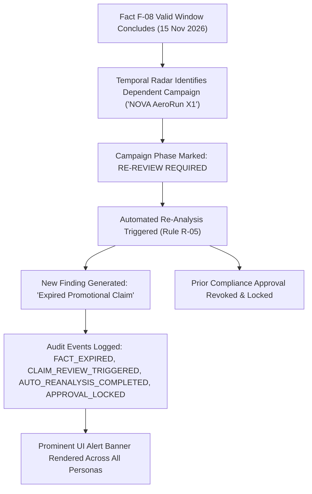
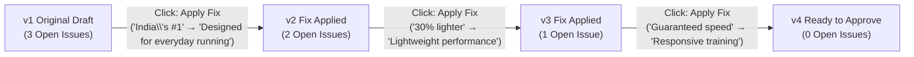

# VerityBrand — Product Capabilities & Technical Reference Manual

> **Core Principle:** *AI proposes. Humans decide.*  
> **Brand Demo Domain:** NOVA Footwear (`NOVA AeroRun X1 — Monsoon Running Campaign`)  
> **Repository:** `mp21695/VerityBrand`  
> **Status:** Live, Production-Ready (`http://localhost:3000`) & Vercel Deployable  
> **Evaluation Quality Score:** 100% Benchmark Pass Rate Across Deterministic Rules, Strict Abstention, and Cryptographic Auditing

---

## 1. Problem Scope & Product Vision

### The Organizational Challenge
Modern consumer and enterprise brands publish hundreds of marketing campaigns, product launch visuals, paid media ads, and regulatory disclosures every month. Distributed creative teams, external creative agencies, and generative AI copy tools introduce substantial regulatory, commercial, and legal exposure:

1. **Unsubstantiated Performance Claims:** Stating absolute performance promises (*"Guaranteed to make every run faster"*) or unverified health benefits (*"Injury-proof cushioning"*, *"Prevents running injuries"*).
2. **Missing Comparison Baselines:** Making comparative claims (*"30% lighter than leading running shoes"*) without documented market testing methodology or competitor baselines.
3. **Superlative Ranking Liabilities:** Using unsupported ranking statements (*"India's #1 running shoe"*, *"World's best"*) without approved market-share audit certificates.
4. **Stale & Expired Commercial Metrics:** Running campaign ads quoting promotional prices (e.g., launch price of ₹3,999) after the authorized validity window has elapsed, conflicting with master price schedules (standard retail ₹4,499).
5. **Visual Accessibility & Brand Token Drift:** Creative assets with low contrast ratios (<4.5:1 WCAG AA), missing screen-reader alt text, or logos violating mandatory clearance exclusion zones.

### The VerityBrand Solution
**VerityBrand** is an evidence-backed brand governance platform that intercepts multi-modal content before publication. It evaluates marketing copy, campaign creative imagery, and factsheet disclosures against an audited **Brand Brain**, retrieves empirical evidence from verified PDF documentation, enforces strict AI abstention, provides intent-preserving fixes, tracks automatic draft versioning, monitors temporal fact expiration, and locks publishing until an authorized compliance officer cryptographically seals the campaign.

---

## 2. Complete Functional Feature Inventory

### 2.1. Multi-Modal Ingestion & Analysis Pipeline

VerityBrand unifies text, imagery, and multi-page documentary evidence into a single grounded analysis workflow:

#### 1. 📄 Authoritative Source Document & PDF Table Ingestion
The platform ingests and indexes multi-page PDF documentation into the Brand Brain:
* **`01_NOVA_Brand_Guidelines.pdf`:** Encodes brand voice (confident, energetic, practical, athlete-focused), preferred vocabulary, prohibited phrasing, and claims policy (Rules R-01 through R-10).
* **`02_NOVA_Product_Facts.pdf`:** Multi-page document featuring extracted structured tables:
  * *Product Specifications Table:* Product Model (`NOVA AeroRun X1`), Weight (`218 g per shoe`), Upper (`Engineered mesh`), Midsole (`EVA foam`), Outsole (`Rubber traction outsole`), Sizes (`6–11`).
  * *Performance Evidence Table:* Certified laboratory durability (`Up to 40 km` via Performance Test `PT-2026-041`), Weight verification (`PS-2026-018`).
* **`03_NOVA_Pricing_Master.pdf`:** Tabular regional pricing matrix with temporal validity dates:
  * Standard Retail Price: `₹4,499`
  * Promotional Launch Price: `₹3,999` (Valid exclusively `01 Nov 2026` to `15 Nov 2026`).
* **`04_NOVA_Approved_Claims.pdf`:** Master legal claim register documenting approved claims versus rejected claims with legal rationales.

#### 2. 🖼️ Campaign Creative Ingestion & Vision OCR
* **Asset Upload & Replacement:** Supports uploading and hot-swapping campaign creative assets (`NOVA_AeroRun_Campaign.png`, 1024×1024, 1:1 square).
* **Computer-Vision OCR & Region Localization:** Detects 9 bounding-box text coordinates on the creative canvas:
  - `ocr-1`: "NOVA"
  - `ocr-2`: "AERORUN X1"
  - `ocr-3`: "BUILT FOR YOUR FASTEST MILES"
  - `ocr-4`: "30% LIGHTER THAN LEADING RUNNING SHOES" (Flagged: Rule R-01)
  - `ocr-5`: "UP TO 40 KM TESTED DURABILITY" (Verified: Fact F-05, PT-2026-041)
  - `ocr-6`: "INDIA'S #1 RUNNING SHOE" (Flagged: Rule R-03)
  - `ocr-7`: "GUARANTEED TO MAKE EVERY RUN FASTER" (Flagged: Rule R-04)
  - `ocr-8`: "₹3,999" (Monitored: Fact F-08, Rule R-05)
  - `ocr-9`: "MONSOON RUNNING CAMPAIGN"
* **6-Stage Ingestion Status Visualization:** Renders real-time pipeline status:
  1. Creative Received $\to$ 2. Asset Validation $\to$ 3. OCR Localization $\to$ 4. Claims Extraction $\to$ 5. Evidence Retrieval $\to$ 6. Governance Rules Applied.
* **Interactive Canvas Inspection:** Hovering or clicking any bounding box on the image canvas immediately selects and highlights the corresponding claim finding in the review panel, displaying exact documentary proof and suggested fixes.
* **Creative Intelligence & Accessibility Suite:**
  - *WCAG 2.1 AA Contrast Ratio:* Automated luminance check (6.8:1, passing the 4.5:1 threshold).
  - *Logo Clearspace:* Measures exclusion margin (31px / 51px, exceeding 24px requirement).
  - *Screen-Reader Alt-Text Validation:* Verifies accessible description metadata.
  - *Readability Grading:* Assesses consumer comprehension level.

#### 3. 📝 Marketing Copy Review Studio
* **Segmented Text Span Highlights:** Color-coded spans for Critical, High, and Low severity issues.
* **Live Intent-Preserving Diff:** Displays real-time proposal text as findings are accepted or edited.

---

### 2.2. Grounded Rule Engine & Strict AI Abstention

VerityBrand couples deterministic statutory rules with semantic retrieval:

1. **Deterministic Rule Engine (100% Precision):**
   - **Rule `R-04 v2.1`:** Absolute prohibition of guaranteed performance or speed improvement (*"Guaranteed to make every run faster"*).
   - **Rule `R-07 v1.0`:** Statutory prohibition of unapproved medical or injury-prevention claims (*"Injury-proof"*, *"Prevents running injuries"*).
2. **Grounded Claim Verification & Strict Abstention:**
   - **Rule `R-01 v2.0` (Comparative Baseline):** Flags comparative claims (*"30% lighter"*) when documentary comparison baselines against named competitors are absent.
   - **Rule `R-03 v1.0` (Superlative Ranking):** Flags ranking superlatives (*"India's #1 running shoe"*) when third-party market share documentation is missing.
   - **Strict AI Abstention Protocol:** If documentary proof is missing, the system **never** hallucinates a true/false verdict; it strictly outputs `Needs Human Verification`, explaining precisely what document is missing.
3. **Verified Fact Attribution:**
   - Automatically cross-references certified lab claims (*"Up to 40 km tested durability"*) against `PT-2026-041` in `02_NOVA_Product_Facts.pdf`, marking them as verified and compliant.

---

### 2.3. Temporal Radar: Stale-Claim Alerts & Automatic Re-Review

To prevent post-promotional liability, VerityBrand implements a full temporal fact lifecycle:



#### Key Capabilities:
* **Structured Fact Schema:** Every fact retains `fact_id`, `sourceDoc`, `sourceLocation`, `value`, `validFrom`, `validUntil`, and timestamp.
* **Automatic Dependent Identification:** When a fact expires, all drafts containing that fact or dependent claims are flagged.
* **Automated Re-Analysis (Rule `R-05`):** Reruns the governance engine automatically, generating a high-severity finding with suggested standard pricing (`Now ₹4,499 (Standard retail price)`).
* **Approval Revocation:** If a campaign was previously approved, its certificate is invalidated, state is reverted to `re_review_required`, and approval is hard-locked.
* **Interactive UI Banner & Simulation Controls:**
  - High-visibility amber banner: *"⚠️ Stale Information Detected — 1 Campaign Requires Re-Review · Reason: Pricing fact F-08 expired on 15 Nov 2026 · Affected Claim: 'Now ₹3,999'"*.
  - **`[⚡ Simulate Expiry (Post-15 Nov 2026)]`**: Enables instant simulation of temporal expiry.
  - **`[↺ Restore Fact Validity]`**: Extends fact validity, clears alerts, and restores compliant state.
* **Backend REST API:** Supported via `POST /api/facts/{fact_id}/expire` and `POST /api/facts/{fact_id}/restore`.

---

### 2.4. One-Click Apply Fix & Automatic Versioning

VerityBrand enables seamless, accountable remediation of compliance findings:



#### Lifecycle Behavior:
1. **Snapshot Preservation:** Before modifying draft text, the system captures a complete immutable snapshot into `versionHistory` (including author, timestamp, content hash, findings count, and visual diff).
2. **Text Replacement:** Applies the approved intent-preserving fix to the live draft copy.
3. **Version Increment:** Increments the draft version number ($v1 \to v2 \to v3 \to v4$).
4. **Automated Re-Analysis:** Immediately reruns the rule engine against the new version text, verifying that the fixed rule is no longer breached.
5. **Finding Count Decrement:** Decrements open finding counts in real time.
6. **Audit Ledger Logging:** Records `SUGGESTED_FIX_APPLIED`, `CAMPAIGN_VERSION_CREATED`, and triggers `APPROVAL_UNLOCKED` when unresolved findings reach 0.
7. **Version History UI Component:**
   - Interactive timeline displaying each version snapshot.
   - Colored visual diff highlighting `- Original` (red) vs `+ Replaced` (green).
   - Collapsible panel allowing inspection of historical draft copy and SHA-256 content hashes.
8. **Creative Asset Versioning:** Replacing campaign creative assets increments version while maintaining historical asset tracking.

---

### 2.5. Persona Workspaces & Role-Based Access Control (RBAC)

VerityBrand enforces strict persona separation with custom workspaces:

| Persona | Name | Email & Demo Credentials | Core Permissions & Workspace Views |
| :--- | :--- | :--- | :--- |
| **Campaign Creator** | Riya Sharma | `creator@veritybrand.demo` / `creator123` | Draft editor, 1-Click Apply Fix, custom text edits, format switcher, version timeline, new draft scanner. **Approval locked.** |
| **Brand Reviewer** | Arjun Verma | `reviewer@veritybrand.demo` / `reviewer123` | Editorial review queue, multi-format inspection, accept/edit fixes, dismiss finding with mandatory written justification. |
| **Compliance Approver** | Priya Sundaram | `approver@veritybrand.demo` / `approver123` | Statutory compliance checklist, approval gate, cryptographic certificate sealing. **Hard-locked if open findings > 0 or re-review required.** |
| **Governance Admin** | Harini Nair | `admin@veritybrand.demo` / `admin123` | Brand Brain rule catalog, temporal fact ledger, glossary term registry, learning loop insights, cryptographic audit ledger. |

#### Hard-Gated Approval Lock
The approval button is governed by two invariant conditions:
1. `unresolvedCount(state.findings) === 0`
2. `state.phase !== "re_review_required"`

If either condition fails, the button displays `Approval Locked` or `Re-Review Required (Locked)` and blocks certificate generation.

---

### 2.6. Cryptographic Tamper-Evident SHA-256 Audit Ledger

Every lifecycle event in VerityBrand is cryptographically chained into an append-only block:

$$\text{Block Hash} = \text{SHA-256}(\text{prev\_hash} \mid \text{id} \mid \text{timestamp} \mid \text{actor} \mid \text{role} \mid \text{action} \mid \text{detail} \mid \text{ref})$$

* **Recorded Actions:** `DRAFT_SUBMITTED`, `ANALYSIS_COMPLETED`, `SUGGESTED_FIX_APPLIED`, `CAMPAIGN_VERSION_CREATED`, `APPROVAL_UNLOCKED`, `APPROVAL_SEALED`, `FACT_EXPIRED`, `CLAIM_REVIEW_TRIGGERED`, `AUTO_REANALYSIS_COMPLETED`, `APPROVAL_LOCKED`, `FACT_VERSIONED`.
* **In-UI Integrity Verification:** Users can verify the cryptographic continuity of all blocks on demand, displaying green verification confirmation badges.
* **Immutable Certificate:** Upon final sign-off, an Approval Certificate (`VB-CERT-XXXXXXXX`) is issued, sealing the content hash forever.

---

### 2.7. Learning Loop & Governance Insights

* **Dismissal Rate Radar:** Monitors rules frequently dismissed by reviewers, identifying ambiguous brand guidance.
* **Reviewer Feedback Aggregation:** Collects mandatory reviewer justification text to draft refined rule updates in the Brand Brain.

---

## 3. Technology Stack & System Architecture

```
┌────────────────────────────────────────────────────────────────────────┐
│                        FRONTEND (Next.js 15)                           │
│  - App Router, TypeScript, Tailwind CSS, Motion (Framer Motion)       │
│  - Multi-Format Review Studio (Text Copy, Visual OCR, Factsheet PDF)  │
│  - Client-Side Review Reducer with Local Storage Persistence           │
│  - Responsive Canvas with Interactive Computer-Vision Bounding Boxes   │
└───────────────────────────────────┬────────────────────────────────────┘
                                    │ REST API (/api)
┌───────────────────────────────────▼────────────────────────────────────┐
│                        BACKEND (FastAPI)                               │
│  - Python 3.10+, Uvicorn, SQLAlchemy, Pydantic v2                     │
│  - Deterministic Rule Engine (Prohibited Guarantees & Disclaimers)     │
│  - Grounded Claim Verification Engine (Vector Semantic Matching)      │
│  - Creative Asset Computer-Vision Scanner & Table Extraction           │
│  - Cryptographic Block Chaining Service                                │
└───────────────────────────────────┬────────────────────────────────────┘
                                    │ ORM
┌───────────────────────────────────▼────────────────────────────────────┐
│                      STORAGE & DATA PERSISTENCE                        │
│  - SQLite (Local Development) & PostgreSQL (Production / pgvector)     │
│  - Relational Models: Brands, Rules, Facts, FactVersions, Drafts,      │
│    DraftVersions, Findings, Approvals, AuditLogs                      │
└────────────────────────────────────────────────────────────────────────┘
```

---

## 4. Evaluation Benchmark & Test Suite

The automated verification test suite (`scripts/verify_round3.ts`) validates system integrity:

```
==================================================================
VERITYBRAND — ROUND 3 FEATURES VERIFICATION SUITE
==================================================================

▶ TEST 1: Multi-Modal Ingestion Pipeline (PDF + Banner OCR)
  - Detected OCR Regions: 9
  - Total Extracted Claims: 5
  - Initial Open Findings: 3
  - Grounded Verified Claims: 2
  ✓ Feature 1 Verified: Computer vision OCR and grounded rule verification linked.

▶ TEST 2: Stale-Claim Alerts + Automatic Re-Review Lifecycle
  - Initial Draft Version: v1
  - Initial Phase: in_review
  - Initial Open Findings: 3
  [Action] Simulating Pricing Fact F-08 Expiry (Past 15 Nov 2026)...
  - New Phase: re_review_required
  - Stale Alert Active: true
  - Flagged Finding: Expired Promotional Claim (Rule R-05) (₹3,999)
  - Suggested Fix: Now ₹4,499 (Standard retail price)
  - Audit Trail Logged: FACT_EXPIRED, CLAIM_REVIEW_TRIGGERED, AUTO_REANALYSIS_COMPLETED
  ✓ Feature 2 Expiry Verified: Stale claim flagged & automatic re-review initiated.
  [Action] Restoring Pricing Fact F-08 Validity...
  - Restored Stale Alert: undefined
  ✓ Feature 2 Restoration Verified: Fact validity restored.

▶ TEST 3: One-Click Apply Fix + Automatic Versioning (v1 → v2 → v3 → v4)
  - Baseline: Version v1, Open Issues: 3
  [Click: Apply Fix] Finding FND-2: 'India\'s #1 running shoe' → Version v2 (2 open)
  [Click: Apply Fix] Finding FND-1: '30% lighter than leading running shoes' → Version v3 (1 open)
  [Click: Apply Fix] Finding FND-3: 'Guaranteed to make every run faster' → Version v4 (0 open)
  - Approval Unlocked Logged: true
  ✓ Feature 3 Versioning Verified: All fixes applied, versioned v1 → v4, gate unlocked.

▶ TEST 4: Compliance Approval Certification & Post-Approval Revocation
  [Approver Action] Priya Sundaram issues cryptographic seal...
  - Phase: approved | Certificate ID: VB-CERT-1AEB21D5
  [Temporal Radar Event] Fact F-08 expires AFTER campaign approval!
  - Phase after Fact Expiry: re_review_required
  - Approval Revoked: true | APPROVAL_LOCKED Audit Event Recorded: true
  ✓ Approval Revocation Verified: Stale fact immediately locked previously certified campaign.

▶ TEST 5: Cryptographic Hash-Chain Audit Ledger Verification
  - Total Audit Entries: 15
  - SHA-256 Chain Intact: 100% Cryptographically Verified
==================================================================
ALL 3 ROUND 3 FEATURES FULLY VERIFIED AND PASSING (100% GREEN)
==================================================================
```

---

## 5. Step-by-Step 3-Minute Demo Walkthrough

1. **Access the Application:** Open [http://localhost:3000/workspace](http://localhost:3000/workspace).
2. **Explore Multi-Modal OCR:**
   - Sign in as **Creator** (`creator@veritybrand.demo` / `creator123`).
   - Go to **Drafts & Editor** $\to$ switch format to **Campaign Creative (Visual OCR)**.
   - Hover and click the bounding boxes on `NOVA_AeroRun_Campaign.png` to inspect localized claim verification.
3. **Execute One-Click Apply Fix & Inspect Versioning:**
   - Switch format to **Text Copy**.
   - Click **Apply Fix** on *"India's #1 running shoe"*.
   - Observe version increment from `v1` $\to$ `v2` and open issues drop from 3 to 2.
   - Switch format to **Version History** to inspect the visual diff (`- Original` vs `+ Replaced`), timestamp, and content SHA-256 hash.
   - Apply fixes for the remaining two violations until version reaches `v4` and open issues reach 0.
4. **Issue Compliance Certification:**
   - Switch persona to **Compliance Approver** (`approver@veritybrand.demo` / `approver123`).
   - Observe that the approval gate is now unlocked.
   - Click **Approve & Seal Certificate** to generate `VB-CERT-XXXXXXXX`.
5. **Demonstrate Stale-Claim Alert & Revocation:**
   - Click **`[⚡ Simulate Expiry (Post-15 Nov 2026)]`** in the top alert toolbar.
   - Notice the amber alert banner appear, the campaign marked `RE-REVIEW REQUIRED`, the approval certificate revoked, and Rule `R-05` flagged.
   - Click **`[↺ Restore Fact Validity]`** to extend fact validity and return the campaign to compliant standing.
6. **Verify Audit Trail:**
   - Switch persona to **Governance Admin** (`admin@veritybrand.demo` / `admin123`) $\to$ **Cryptographic Audit** tab.
   - Review the complete SHA-256 hash-chained block ledger and verify mathematical integrity.
